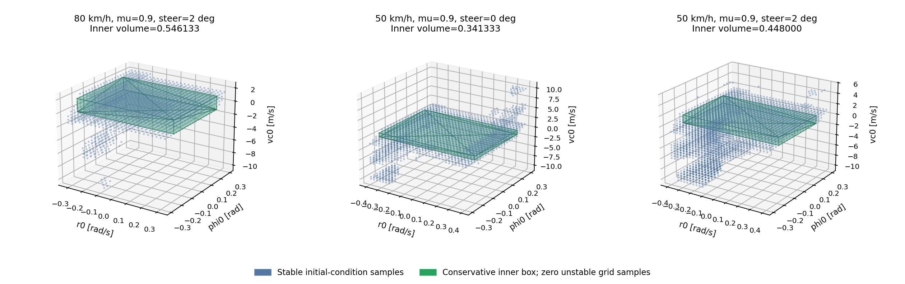

# 정상 타이어 우선 계산 · 영역 수정본

**3/3 계산·저장·검증 완료.** 이 폴더의 세 MAT가 최신 수정본입니다. 각 파일은 정상 타이어 한 CASE만 포함합니다.

초기 횡속도·요레이트·조향각으로 초기 슬립각과 휠 회전속도를 설정했습니다. 초기조건 39,401개, 5초, Ts=0.01초, RK4 하위 적분 20회를 유지했습니다.

기존 여덟 지지점 방식이 유효한 내부 영역을 찾지 못할 때만 모든 내부 격자점이 안정인 최대 축 정렬 박스를 사용합니다. 안정/불안정 판정과 좌표는 원본 시뮬레이션과 바이트 단위로 같고, 115개 검증 항목을 통과했습니다. 이는 격자 표본에 대한 보수적 영역이며 격자 사이 모든 연속 상태의 안정성을 증명하지 않습니다.

| 조건 | MAT 다운로드 | 안정점 | 내부 부피 |
|---|---|---|---|
| 80 km/h · μ=0.9 · 2° | [다운로드](https://raw.githubusercontent.com/yodagil/suspension/main/results/kinematic_initialization_healthy/stable_point_80kph_0.9mu_2deg.mat) | 3062 | 0.546133333 |
| 50 km/h · μ=0.9 · 0° | [다운로드](https://raw.githubusercontent.com/yodagil/suspension/main/results/kinematic_initialization_healthy/stable_point_50kph_0.9mu_0deg.mat) | 2847 | 0.341333333 |
| 50 km/h · μ=0.9 · 2° | [다운로드](https://raw.githubusercontent.com/yodagil/suspension/main/results/kinematic_initialization_healthy/stable_point_50kph_0.9mu_2deg.mat) | 4197 | 0.448000000 |

[전체 검증](validation_summary.json) · [단일 MATLAB 코드](../../matlab/stability_sweep_210.m) · [MATLAB 그림 함수](../../matlab/plot_stability_mat.m)

