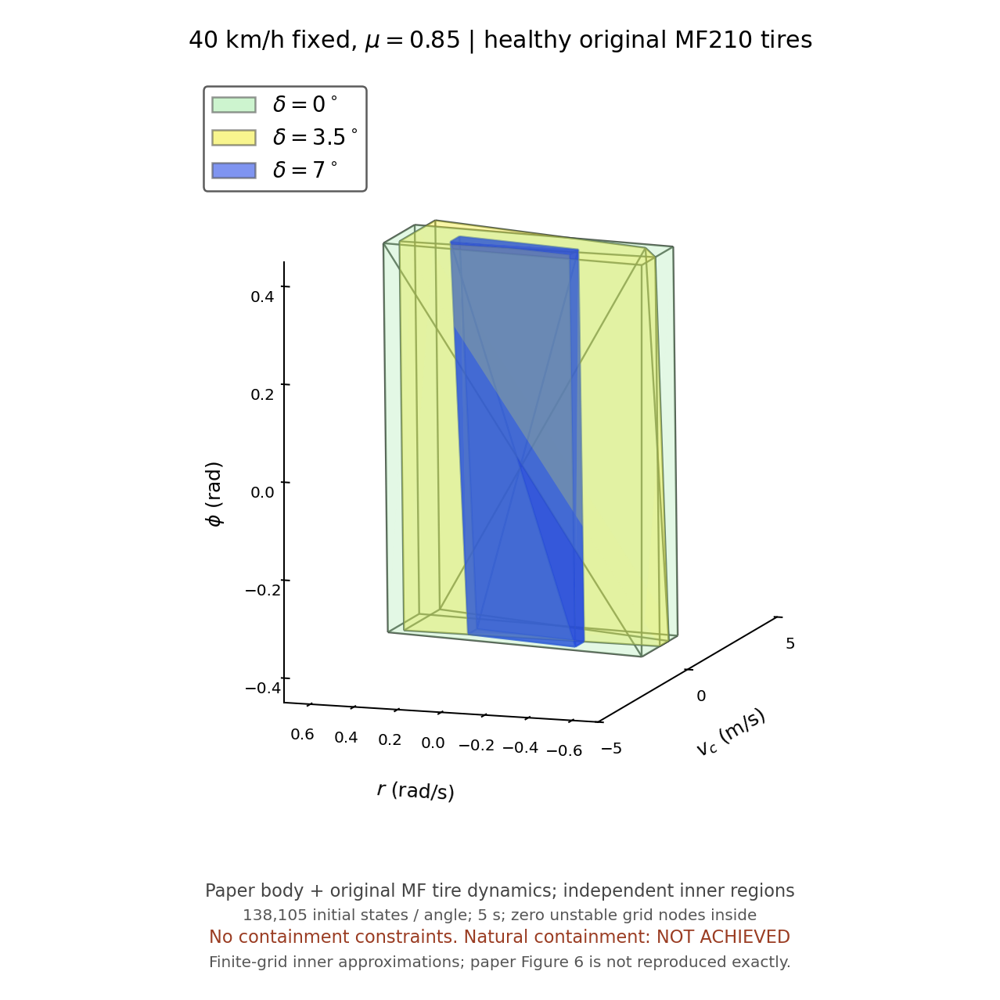

# 기존 210개 계산의 MF 타이어를 적용한 논문 차체 모델

40 km/h 고정, μ=0.85, 정상 타이어, 전륜 조향각 0°/3.5°/7°를 각각 계산했습니다. 기존 결과는 덮어쓰지 않았고 210개 일괄 계산은 재개하지 않았습니다.

**논문 그림의 포함관계는 재현되지 않았습니다.** 독립 추출한 내부 영역의 부피는 줄었지만, `0° ⊃ 3.5° ⊃ 7°`는 성립하지 않습니다. 교집합, 다른 각도에 따른 좌표 조정, 크기 보정으로 포함을 만들지 않았습니다.

| 전륜 조향각 | 안정 초기상태 | 선택 내부 영역 부피 | 극점 / 평면 면 수 | 내부 불안정 격자점 |
| --- | ---: | ---: | ---: | ---: |
| 0° | 14,416 | 1.7991111111 | 8 / 7 | 0 |
| 3.5° | 14,685 | 1.2017777778 | 8 / 8 | 0 |
| 7° | 3,069 | 0.2275555556 | 8 / 8 | 0 |

위 부피는 원본 210 코드의 알고리즘이 고른 **내부 다면체**의 부피입니다. 전체 안정 초기상태 집합의 부피와 같지 않습니다. 특히 3.5°의 안정 표본 수는 0°보다 많으며, 원시 안정 집합도 단조 축소하지 않습니다. 부피의 단위는 좌표 `[vc(m/s), r(rad/s), phi(rad)]`의 곱입니다. 선택 점이 8개여도 정확한 6면체가 되는 것은 아닙니다.

## 파일과 실행

- `stable_point_40kph_0.85mu_0deg.mat`
- `stable_point_40kph_0.85mu_3.5deg.mat`
- `stable_point_40kph_0.85mu_7deg.mat`

각 MAT는 `PAPER_STABILITY3D`(설정, 원시 판정, 초기 좌표, 최종 18상태, 진단값)와 `REGION210`(독립 추출한 다면체, 출처)을 함께 포함합니다. 원시 판정과 꼭짓점은 계산 결과에서 변경하지 않았으며 저장 후 재로딩해 일치를 확인했습니다.

실행 가능한 단일 파일은 [run_mf210_hybrid.m](../../paper_model_mf210/run_mf210_hybrid.m), 전체 코드 ZIP은 [MF210_PaperBody_40kph_Code.zip](../../downloads/MF210_PaperBody_40kph_Code.zip)입니다. 단일 `.m` 파일은 외부 함수 없이 실행할 수 있습니다. 저장 결과를 다시 그릴 때는 `plot_mf210_hybrid`에 MAT 3개가 있는 폴더를 지정합니다. MATLAB 그래픽스와 현재 Python 그림의 투명도 표현은 다를 수 있습니다.

## 모델과 계산 조건

차체는 Xiao 등(2022)의 운동/롤 식을 사용하고, 타이어는 기존 210개 코드의 정상 MF 계수·오프셋·종방향 우선 마찰 타원·슬립 완화·자유회전 휠을 연결한 **18상태 혼합 모델**입니다. 논문의 Burckhardt 모델과 동일한 모델 또는 기존 Full-Car 차체 전체 모델은 아닙니다. 논문 DOI: `10.1016/j.aei.2022.101764`.

MF의 기준 수직하중 5425 N, 힘 계산 하중 범위 100~16000 N, 마찰 스케일 `μ/0.9`를 원본대로 유지했습니다. MF 최대 힘을 `μFz`에 새로 정규화하지 않았습니다. `Rw=0.36 m`, `Iw=1.8 kg·m²`, 슬립 완화 길이 0.35/0.75 m도 원본 값입니다. 논문의 Eq.11 하중은 원본 210 코드의 0.03초 `ay_load` 필터를 사용합니다. `ms=1300 kg`, `hphi=0.54 m`는 논문에 수치가 없는 항목에 둔 명시적 가정이며 논문 공개값으로 간주하지 않았습니다.

초기 타이어 상태는 기존 210 코드와 같은 `alpha=-delta`, `kappa=0`, `omega=ux*cos(delta)/Rw`, `ay_load=0`입니다. 각 격자점의 `vc,r`에 맞춘 슬립 초기화로 변경하지 않았습니다. 같은 3차원 차체 초기 좌표라도 조향각에 따라 숨은 타이어 초기 상태와 동역학이 달라지므로, 안정 집합의 포함관계가 자동으로 보장되지 않습니다.

격자는 `vc=-10:0.25:10`, `r=(-27:27)*(0.8/30)`, `phi=(-15:15)*(0.8/30)`로 81×55×31=138,105개/조건입니다. yaw rate는 ±0.72까지이고 기존 점과 간격을 유지합니다. 기존 횡속도 점을 모두 유지하며 그 사이를 보강했습니다. 5초 동안 0.01초 간격으로 `|r|≤0.85*μ*g/u`, `|ay|≤μ*g`, 원시 휠 하중 `Fz>0`을 검사했습니다. RK4 내부 시간 간격은 0.0005초입니다. 실패 표본의 진단값은 첫 위반 시점까지이며 안정 표본은 5초 전체를 계산했습니다.

전체 격자는 MATLAB 호환 M-code와 수치 일치를 검증한 C++로 실행했습니다. 실제 MATLAB 실행 파일은 이 환경에 없으며 M-code 검증은 Octave에서 수행했습니다. C++ 원본도 코드 ZIP에 포함했습니다.

## 검증 결과와 한계

`native_mcode_parity.json`에서 RHS 480개, 적분 스텝 480개, 초기상태 225개의 판정이 M-code와 일치함을 확인할 수 있습니다. 세 정밀 계산의 수치 실패는 모두 0개입니다.

`region_audit.json`은 각 다면체에 대해 **전체 원시 불안정 격자점**이 내부/경계에 없는지, 꼭짓점이 실제 안정 격자점인지, 부모 영역의 모든 면 부등식을 자식 꼭짓점이 만족하는지 검사합니다. 결과는 3.5°→0° 실패, 7°→3.5° 실패, 7°→0° 성공입니다. 원시 집합에서는 각각 2,551/171/40개의 비포함 초기상태가 있습니다. 영역 추출의 계산 시간을 줄이기 위해 0°/3.5°에서 후보 볼록껍질의 범위 밖임이 확실한 점의 반복 검사만 생략했으며, 선택 알고리즘·좌표는 그대로입니다. 필터 없이 계산한 독립 구현과 결과가 정확히 일치하고 최종 검사는 생략 없이 수행했습니다.

`counterexample_half_dt_checks.json`의 비포함 사례 4개는 관측 및 적분 시간 간격을 절반으로 줄인 M-code에서도 같은 판정을 유지했습니다. 예를 들어 `[vc,r,phi]=[1,-0.0533333333,0.2933333333]`는 3.5°에서 안정이지만 0°에서 횡가속도 기준을 위반합니다. `vertex_half_dt_checks.json`에서는 24개 꼭짓점이 모두 0.005초 관측/0.00025초 적분에서도 안정 판정을 유지합니다.

세 조건 모두 선택 롤 좌표와 일부 안정 표본이 격자 경계 ±0.4 rad에 닿습니다. 따라서 롤 방향의 전체 물리적 안정 경계를 찾았거나 조향 증가에 따른 롤 범위 축소를 재현했다고 주장할 수 없습니다. 또한 내부 불안정 **격자점** 0개는 연속 공간 전체의 안정성을 보장하지 않습니다. 원본 논문 그림과의 완전한 일치는 미달 상태입니다.

`MANIFEST.json`에 파일별 해시와 원시 계산/추출 MAT의 해시를 기록했습니다. 원래 계산 계획에 남아 있던 예비 정적 엔진의 출처 해시는 별도 이력으로 표시했고, 실제 동적 엔진의 검증·계산 해시는 일관되게 보존했습니다.
