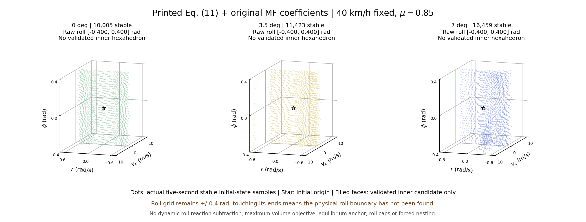

# MF 유지 · 논문 식 (11) / §3.1 기준선 결과

완료 **3/3**. 전체 조건 계산을 마쳤습니다.

40 km/h 고정, μ=0.85, 정상 타이어, 조향각 0°/3.5°/7°입니다. 기존 MF 계수·오프셋·하중 민감도·마찰 타원·μ/0.9 배율을 유지하고, 수직하중은 논문에 인쇄된 식 (11)로 복원했습니다. 이전 결과는 덮어쓰지 않았으며 원래 210개 계산은 재개하지 않았습니다.

| 조향각 | 안정 표본 | 물리적 불안정 | 수치 미해결 | 원시 안정점 롤 범위 (rad) | §3.1 내부 후보 |
| --- | ---: | ---: | ---: | --- | --- |
| 0° | 10,005 | 125,748 | 2,352 | -0.4000 ~ +0.4000 | 검증된 육면체 없음 |
| 3.5° | 11,423 | 124,417 | 2,265 | -0.4000 ~ +0.4000 | 검증된 육면체 없음 |
| 7° | 16,459 | 119,551 | 2,095 | -0.4000 ~ +0.4000 | 검증된 육면체 없음 |

## 코드와 데이터

- [단일 MATLAB 파일](../../paper_model_mf210_eq11_baseline/run_mf210_eq11_baseline.m)
- [전체 코드 ZIP](../../downloads/MF210_Eq11_Baseline_40kph_Code.zip)
- 파일명은 `stable_point_40kph_0.85mu_0deg.mat`, `..._3.5deg.mat`, `..._7deg.mat`입니다. 완료된 조건부터 추가합니다.

MAT에는 `PAPER_STABILITY3D`(설정·원시 판정·좌표·진단), `SECTION31`(극값 추출 단계·분기·격자 경계 진단), `INNER_REGION`(검증 결과와 후보 좌표)을 넣었습니다. `numerical_unresolved_mask`와 `unresolved_points`는 물리적 불안정점과 구분됩니다. `INNER_REGION.valid=false`이면 유효 내부 부피는 NaN이고 후보의 좌표·부피는 별도 `candidate_*` 필드 및 `SECTION31.inner_candidate`에 남습니다. 실패를 다른 도형으로 대체하지 않습니다.

## 식 (11)과 영역 추출

하중이동 모멘트는 `D=m*h*ay+ms*g*hphi*sin(phi)`입니다. 이전의 `-Ixx*pdot` 확장과 하중 지연 상태는 제거했습니다. 매 RHS 및 RK4 단계에서 같은 시점의 가속도가 하중과 MF 힘을 동시에 만족하도록 풀며 잔차 허용치는 2e−10 m/s²입니다. 원래 MF의 100 N 힘 활성화 불연속은 보존했습니다. 해가 검증되지 않거나 분기가 모호하면 수치 미해결로 남깁니다. 빠른 secant 경로에 전역 유일근 증명을 주장하지 않습니다.

미해결의 대표 6건은 최초 실패 RK 단계에서 별도로 추적했습니다. 독립적인 촘촘한 근 탐색에서도 유효 근을 찾지 못했고, 원래 MF의 100 N 힘 활성화 지점에서 잔차가 0을 건너뛰었습니다. 이 자료는 `validation/representative_unresolved_failure_explanation.md`에 있습니다. 모든 미해결점의 원인이 같다고 확인한 것은 아니며, 임의로 힘 활성화 조건을 바꾸거나 이를 물리적 불안정으로 재분류하지 않았습니다.

영역 추출은 **고정 vc·r에서 롤 극값 → 고정 r·phi에서 횡속도 내·외 경계 → 8개 극점 후보 → 내부 후보 검증** 순서입니다. 최대 부피 목적함수·평형점 포함 조건·롤각 캡·조향각별 좌표 보정·강제 포함은 없습니다. 논문에 실행 가능한 격자 분기·동률·8꼭짓점 선정 규칙이 없어 명시적인 수치 해석으로 보완했습니다. 세부사항은 [방법 설명](../../paper_model_mf210_eq11_baseline/GEOMETRY_METHOD.md)에 있습니다.

후보는 실제 극점 8개, 평면 사각면 6개, 양의 부피를 가지며 모든 비안정·미해결 격자점을 내부·경계에서 배제해야 표본 기준의 내부 육면체로 승인됩니다. 기준을 통과하지 못한 후보와 이유는 저장합니다. 이것은 연속 공간 전체의 수학적 안정성 증명이 아닙니다.

**롤 격자 끝 ±0.4 rad까지 안정점이 있으면 물리적 롤 경계를 찾은 것이 아닙니다.** `SECTION31.roll_domain_censored_slices`와 `physical_roll_boundary_resolved`로 확인할 수 있습니다. 전체 원시 안정점의 범위와 선택한 도형의 범위를 구분해야 하며, 도형 밖이라는 이유로 그 초기상태가 불안정하다고 판정하지 않습니다.

## 실행·검증 범위

81×55×31=138,105개 초기상태/조건, vc 간격 0.25 m/s, yaw 범위 ±0.72 rad/s·간격 0.0266667, 롤 범위 ±0.4 rad·같은 간격입니다. p(0)=0, 5초, 0.01초 관측, RK4 내부 간격 0.0005초입니다. 판정은 `|r|<=0.85*mu*g/u`, `|ay|<=mu*g`, 원시 휠 하중 양수입니다. 요레이트 한계는 논문 이상 요레이트 식 (13)을 분류에 재사용한 해석입니다.

전체 계산은 C++로 수행했습니다. MATLAB 호환 M-code는 GNU Octave 9.4에서 RHS·스텝·소규모 궤적 판정 및 단일 파일 실행을 대조했으며 실제 라이선스 MATLAB 실행은 하지 않았습니다. 영역 추출도 33개 합성 사례에서 Python/M-code를 대조했습니다. 저장 뒤 원시 마스크·좌표가 바뀌지 않았는지 확인했습니다. 검증 자료는 `validation/`에 있습니다.

전체 세 마스크의 극값 추출도 Python과 M-code에서 대조해 일치했습니다. 7°는 계산식을 바꾸지 않고 2스레드로 재시작했으며, 기존 1스레드 벤치마크 181개 대응 궤적과 모든 CSV 필드가 비트 단위로 같았습니다. 최종 MAT의 원시 `result` 모든 필드와 설정이 원래 분류 파일과 동일하고, 안정·물리적 불안정·수치 미해결이 모든 초기상태를 겹침 없이 분할하는지 확인했습니다.

기존 210개 타이어의 완화·휠 회전 과도상태 전체 대신 순간 슬립각과 자유회전 `kappa=-Shx`를 쓰는 5상태 모델입니다. 논문은 Burckhardt를 사용하므로 MF 결과와 같을 근거는 없습니다. `ms=m=1300 kg`, `hphi=h=0.54 m`, 고정속도 유지 방식·초기 p·5초·격자·분기 규칙은 명시적 가정입니다. 따라서 **식 (11)과 §3.1 순서를 복원한 MF 기준선**이며 저자의 Figure 6을 완전히 복구했다는 주장은 하지 않습니다.

[§3.1 추출 단계 그림](section31_extraction_stages.png)
