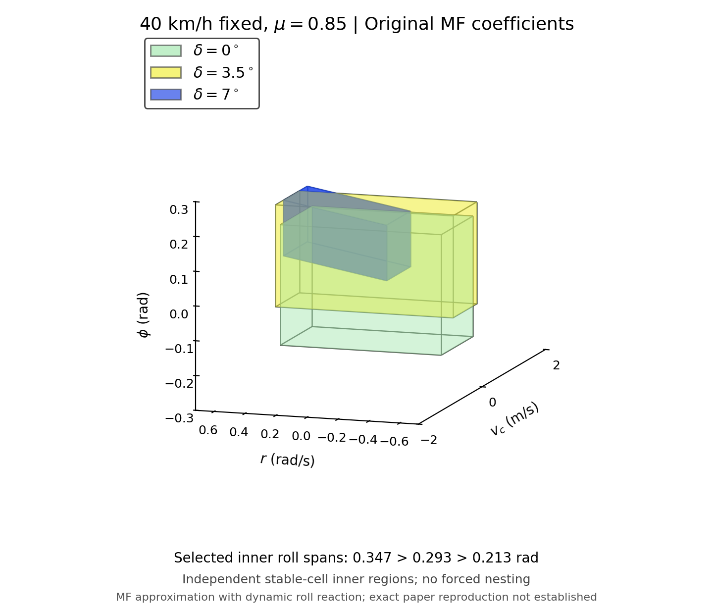

# MF 계수를 유지한 40 km/h 안정영역 근사

40 km/h 고정, μ=0.85, 정상 타이어, 조향각 0°/3.5°/7°입니다. 원래 MF 계수와 앞서 완료한 414,315개 초기상태의 원시 시뮬레이션 결과를 유지하고, 내부 육면체 선택을 보수적인 안정 셀 기반 방식으로 검토했습니다. 원래 210개 계산은 재개하지 않았습니다.

| 조향각 | 선택 내부 영역 롤 범위 (rad) | 전체 롤 폭 (rad) | 내부 부피 | 원시 안정점 수 |
| --- | --- | ---: | ---: | ---: |
| 0° | −0.186667 ~ +0.160000 | 0.346667 | 0.360533 | 4,554 |
| 3.5° | −0.106667 ~ +0.186667 | 0.293333 | 0.252267 | 4,811 |
| 7° | −0.026667 ~ +0.186667 | 0.213333 | 0.080000 | 3,247 |

**선택한 보수적 내부 영역의 롤 폭과 부피는 조향각이 커지면서 감소합니다.** 전체 원시 안정점의 롤 극값은 모두 ±0.186667 rad이며, 원시 집합 전체의 롤 경계가 차례로 줄어든다는 뜻은 아닙니다. 세 내부 영역도 완전히 포함되지는 않습니다. 논문 Figure 6과 수치·기울기·포함관계가 모두 일치하는 결과라는 주장은 하지 않습니다.

그림의 좌표는 저장된 실제 값이며 모든 조건에 같은 카메라를 사용했습니다. 표시 순서만 `[r,vc,phi]`이고 좌표 이동·축소·조향각별 배율은 없습니다. 주 그림은 vc ±2 m/s로 확대했으며 [vc ±5 m/s 표시 그림](paper_axes_comparison.png)도 함께 제공합니다.

## 코드와 MAT

- [단일 MATLAB 파일](../../paper_model_mf210_final/run_mf210_final.m)
- [전체 코드 ZIP](../../downloads/MF210_Final_40kph_Code.zip)
- [0° MAT](stable_point_40kph_0.85mu_0deg.mat)
- [3.5° MAT](stable_point_40kph_0.85mu_3.5deg.mat)
- [7° MAT](stable_point_40kph_0.85mu_7deg.mat)

MAT에는 `PAPER_STABILITY3D`(설정·원시 판정·좌표·진단), `INNER_REGION`(8개 꼭짓점·6개 면·부피), `EQUILIBRIUM`, `GEOMETRY_VALIDATION`을 저장했습니다. 저장 후 다시 읽어 원시 `result`의 모든 필드가 기존 분류 파일과 동일함을 확인했습니다.

## 이번에 확인한 점

단순히 기존 불안정 격자점만 배제한 기울어진 후보는 격자 사이의 새 표본에서 실패했습니다. 0°는 109개 중 5개, 3.5°는 1개가 횡가속도 한계를 넘었으므로 이 후보를 채택하지 않았습니다. 실패 기록은 `validation/rejected_point_only_oblique_trajectories.json`에 남겼습니다.

최종 선택은 자기 안정 평형점을 포함하는 유한한 기울기 후보군에서, 8개 꼭짓점이 모두 안정인 물리 격자 셀로 지지되는 육면체만 비교합니다. 불안정 꼭짓점을 가진 셀의 보수적인 역변환 투영 범위를 배제합니다. 셀의 내부와 양의 부피로 겹치는 경우를 검사하며, 외부 인접 셀이 영역 경계에 닿기만 하는 것은 허용합니다. 자기 조향각 데이터의 안정 연결성분에서만 기울기를 추정하며 다른 조향각 결과는 선택에 사용하지 않습니다. 해당 **한정된 후보군에서 물리적 부피를 최대화**하고, 정해진 격자 인덱스 사전순으로 동률을 처리합니다. 완전 포함을 만드는 제약이나 목표 롤 폭은 없습니다.

이 규칙에서 0°/3.5°는 기존 직육면체와 같고, 7°는 yaw에 따라 롤 경계가 기울어진 같은 부피의 후보가 선택됐습니다. 롤 전체 폭은 기울어진 영역의 8개 꼭짓점 최소·최대 차이로 계산했으며, 고정 yaw 단면 두께와 혼동하지 않았습니다.

각 최종 영역은 다음 검사를 통과했습니다.

- 전체 원시 불안정 격자점 약 13만 개/조건이 내부·경계에 0개이며, 실제 안정 격자점인 꼭짓점 8개와 평면 면 6개를 가집니다.
- 조건마다 꼭짓점 8개·중심·무작위 내부 100개를 5초 재실행해 109/109가 안정이었고, 관측 간격 0.005초에서도 일치했습니다.
- 꼭짓점은 관측 간격 0.001초에서도 모두 안정이었습니다. 3.5° 최소 휠 하중은 약 1.919 N으로 여유가 작고, 7°는 약 74.601 N입니다.
- 조건마다 별도 Sobol 내부 표본 4,096개와 면 표본 2,646개로 **초기 시점** 한계를 검사해 모두 통과했습니다. 이 6,742개 검사는 5초 전체 궤적 검사가 아닙니다.
- Native 기하 알고리즘은 독립적인 완전탐색 112개 작은 사례·27,693개 후보와 일치했습니다. 새 MATLAB 호환 함수도 24개 작은 사례와 전체 3개 마스크에서 동일한 부피·꼭짓점·동률을 반환했습니다.

연속 공간의 모든 상태가 안정이라는 증명은 아닙니다. 동역학과 MF 함수 본문은 이전 배포본과 동일하며 `paper_model_mf210_final/provenance/core_invariance.json`에 해시를 기록했습니다. M-code 검증은 GNU Octave 9.4를 사용했고 실제 라이선스 MATLAB 실행은 하지 않았습니다.

## 모델 차이

논문은 Burckhardt 타이어를 사용합니다. 여기서는 요청대로 기존 210개 코드의 MF 계수·하중 민감도·힘 오프셋·마찰 타원·μ/0.9 배율을 유지했습니다. 5상태 차체와 순간 바퀴 슬립각, 원래 MF의 자유회전 근 `kappa=-Shx`를 사용하므로 기존 Full-Car 타이어 완화·휠 회전 과도상태 전체를 그대로 계산하는 모델과도 구분됩니다.

수직하중은 논문에 인쇄된 식 (11) 대신 명시적인 동적 롤 반력 확장 `D=D_paper-Ixx*pdot`를 사용합니다. `m=ms=1300 kg`, `h=hphi=0.54 m` 가정에서 `D=1400*p+43100*phi+6886.62*(sin(phi)-phi)`입니다. 공개된 롤 강성·감쇠·관성을 그림에 맞춰 조정하지 않았습니다. 현가질량과 롤센터 등 논문 미공개 값을 식별한 결과가 아닙니다.

초기격자는 81×55×31, 138,105개/조건이고 기존 점을 포함합니다. vc 간격 0.25 m/s, yaw 범위 ±0.72 rad/s·간격 0.0266667, 롤 범위 ±0.4 rad·같은 간격입니다. p(0)=0, 5초, 0.01초마다 `|r|≤0.85*μ*g/u`, `|ay|≤μ*g`, 모든 원시 휠 하중 양수를 검사합니다. RK4 내부 간격은 0.0005초입니다. 원시 전체 계산과 검증에 사용한 C++ 소스도 코드 ZIP에 들어 있습니다.

모든 가정과 유한시간 판정 범위를 포함한 **MF 기반 근사본**이며, 공개되지 않은 논문의 원래 수치 결과를 복구했다고 해석하면 안 됩니다. 이전 결과와 코드는 별도 폴더에 보존했습니다.
