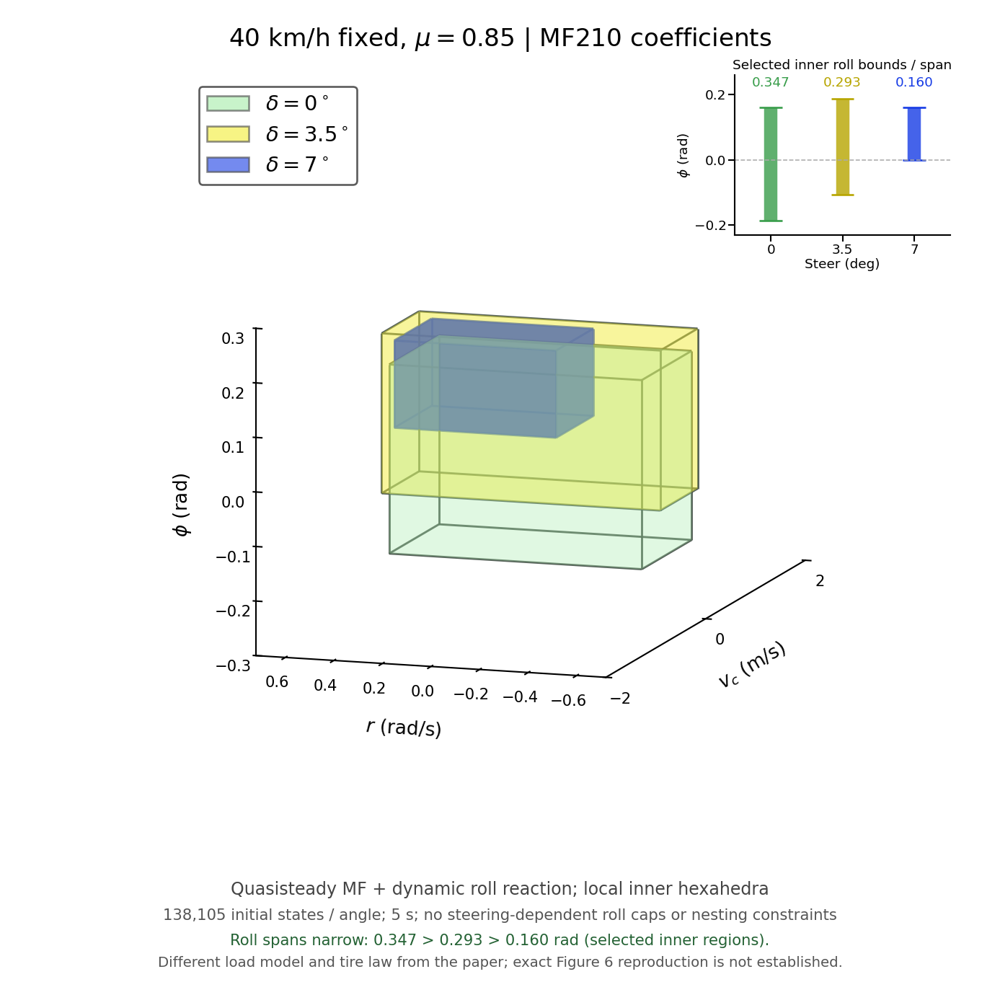

# MF 타이어를 사용한 롤 안정영역 비교

40 km/h 고정, μ=0.85, 정상 타이어, 전륜 조향각 0°/3.5°/7°를 계산했습니다. 기존 210개 계산의 **MF 계수·하중 민감도·힘 오프셋·마찰 타원·μ/0.9 스케일은 유지**했습니다. 이전 계산 결과와 원래 Full-Car 코드는 덮어쓰지 않았습니다.



| 조향각 | 선택 내부 영역 롤 범위 (rad) | 롤각 폭 (rad) | 내부 부피 | 원시 안정 표본 수 |
| --- | --- | ---: | ---: | ---: |
| 0° | −0.186667 ~ +0.160000 | 0.346667 | 0.360533 | 4,554 |
| 3.5° | −0.106667 ~ +0.186667 | 0.293333 | 0.252267 | 4,811 |
| 7° | 0.000000 ~ +0.160000 | 0.160000 | 0.080000 | 3,247 |

**조향 증가에 따른 롤각 폭 감소는 선택한 보수적 내부 육면체에서 확인됐습니다.** 전체 원시 안정점의 롤 최소·최댓값은 세 조건 모두 ±0.186667 rad입니다. 따라서 전체 초기상태 안정 집합의 롤 경계가 이 순서로 줄었다고 주장하지 않습니다. 논문 그림의 좌표·기울기·포함관계를 완전히 재현한 결과도 아닙니다. 서로 다른 조향각의 영역을 포함시키는 조건, 각도별 롤 축소계수, 좌표 이동·스케일 보정은 사용하지 않았으며, 세 영역의 엄밀한 포함관계는 성립하지 않습니다.

## 결과와 단일 MATLAB 파일

결과 MAT 3개에는 `PAPER_STABILITY3D`(모델 설정·메타데이터·원시 판정·좌표·진단값), `INNER_REGION`(8개 꼭짓점·6개 면·범위·부피), `EQUILIBRIUM`(해당 조건의 안정 평형점)을 함께 저장했습니다.

- `stable_point_40kph_0.85mu_0deg.mat`
- `stable_point_40kph_0.85mu_3.5deg.mat`
- `stable_point_40kph_0.85mu_7deg.mat`

외부 보조 함수 없이 실행하는 [run_mf210_paper_roll.m](../../paper_model_mf210_roll/run_mf210_paper_roll.m)과 [전체 코드 ZIP](../../downloads/MF210_PaperRoll_40kph_Code.zip)을 제공합니다. MATLAB 기본 기능만으로 계산하며 대규모 격자의 재계산에는 시간이 소요됩니다. 저장된 MAT를 다시 그릴 때는 함께 제공하는 `plot_mf210_paper_roll`에 이 결과 폴더를 지정합니다. MATLAB과 Python 렌더러의 투명도 표현은 다를 수 있으나 저장 좌표·공통 카메라·축 범위는 같습니다.

## 논문에 가까운 타이어 계산 방식과 롤 하중 보완

논문 DOI는 `10.1016/j.aei.2022.101764`입니다. 논문은 타이어 힘을 순간적인 슬립에서 계산합니다. 이번 비교도 그 구조에 맞춰 바퀴별 실제 속도로 슬립각을 계산하고 기존 MF 힘 함수를 적용한 **준정적 자유회전 타이어 모델**입니다. 기존 Full-Car의 슬립 완화·휠 회전 과도상태 18개를 그대로 실행하는 모델과는 구분됩니다. 원래 210개 계산의 초기화 코드를 수정한 것이 아닙니다.

MF 종방향 힘의 오프셋을 삭제하지 않고, 자유회전 조건 `Fx=0`을 만족하는 원래 MF의 근 `kappa=-Shx`를 사용합니다. 정상 타이어에서는

```text
kappa_free = 0.001635 - 0.0025297*((clipped_Fz-5425)/5425).
```

횡방향 오프셋도 그대로입니다. 기준 하중 5425 N, 힘 계산 하중 범위 100~16000 N, 활성화 조건 `clipped_Fz>100`, 원본의 종방향 우선 마찰 타원을 유지하며 최대 힘을 μFz에 다시 정규화하지 않았습니다.

차체의 횡·요·롤 운동은 논문 식 (2)~(4)를 유지합니다. 다만 **수직하중에는 동적 롤 반력을 추가로 고려하는 물리적 확장**을 사용합니다. 논문에 인쇄된 식 (11) 자체와 같다는 뜻은 아닙니다.

```text
D = m*h*ay + ms*g*hphi*sin(phi) - Ixx*pdot
  = (m*h-ms*hphi)*ay + Cphi*p + Kphi*phi
    + ms*g*hphi*(sin(phi)-phi).
```

명시적 가정 `m=ms=1300 kg`, `h=hphi=0.54 m`에서 가속도 계수가 0이므로,

```text
D = 1400*p + 43100*phi + 6886.62*(sin(phi)-phi)  [Nm].
```

이 모멘트로 좌우 휠 하중을 계산하고, 원시 하중이 0 이하가 되면 휠 들림으로 판정합니다. 임의의 조향각별 롤 한계값을 설정하지 않습니다. 원래 식 (11)의 하중이동에 이 모멘트를 또 더하지 않고 **전체 하중이동 모멘트를 교체**하므로 반력을 중복 합산하지 않았습니다. 공개된 `Ixx=700 kg·m²`, 롤 강성 43100 Nm/rad, 감쇠 1400 Nm/(rad/s)를 그림에 맞추기 위해 조정하지 않았습니다.

이 확장은 CG 기준 유효 롤 관성, 무피치·무히브, 전 질량 현가질량, 고정 축 하중합, 영 능동 현가력, 기존 전후 하중배분을 가정한 근사입니다. 논문에 공개되지 않은 현가질량·롤센터 높이를 식별한 결과나 정확한 비선형 현가장치 모델은 아닙니다. 논문은 Burckhardt 타이어를 사용하므로 이번 MF 모델과 수치가 완전히 같을 근거도 없습니다.

## 독립적인 내부 육면체 선택

각 조건에서 직진 평형점으로부터 조향각을 0.1° 이하씩 증가시키며 정상 주행의 안정 평형점을 추적했습니다. 고정 속도를 제외한 네 동적 상태의 야코비안 고유값 실수부가 음수이고, 평형점과 이를 감싸는 격자점이 안정일 때만 영역을 만듭니다.

자신의 평형점을 포함하면서 **내부의 모든 분류된 격자점이 안정인 격자 정렬 육면체 중 물리적 부피가 최대인 것**을 골랐습니다. 평형점에 영역을 중심 정렬하지 않으며 종횡비·롤 폭·다른 조향각 영역과의 포함관계를 제한하지 않습니다. 부피 동률이면 모든 조건에서 동일한 격자 인덱스 사전순 규칙을 사용합니다. 이 선택법은 논문에 공개되지 않은 꼭짓점 알고리즘을 그대로 복구했다는 주장이 아닌, 명시적인 보수적 내부 근사입니다. 자체 평형점 조건이 없는 전역 최대 육면체는 7°에서 정상 주행 평형점을 제외해 별도로 구분했습니다.

## 계산과 검증

격자는 `vc=-10:0.25:10 m/s`, `r=(-27:27)*(0.8/30) rad/s`, `phi=(-15:15)*(0.8/30) rad`로 138,105개/조건이며 기존 격자점과 yaw 간격을 유지합니다. 5초 동안 0.01초마다 `|r|≤0.85*μ*g/u`, `|ay|≤μ*g`, 모든 원시 휠 하중 `Fz>0`을 검사하고 RK4 내부 간격은 0.0005초입니다. 총 414,315개 초기상태를 계산했고 수치 실패는 없습니다.

전체 계산은 MATLAB 호환 M-code와 대조한 C++로 실행했습니다. 이 환경에서 실제 MATLAB 라이선스 실행 검증은 할 수 없어 M-code는 GNU Octave로 검증했습니다. RHS 최대 차이는 약 2.73e−12, RK4 스텝 차이는 약 2.22e−16이고 225개 소규모 초기조건의 판정이 일치했습니다. 코드 ZIP에 실제 C++ 엔진 소스도 포함했습니다.

세 내부 영역은 각각 실제 안정 격자점 8개, 극점 8개, 평면 면 6개이며 전체 원시 불안정 격자점이 내부·경계에 0개입니다. 24개 꼭짓점과 중심·내부 무작위 표본은 0.01/0.005초 관측에서 안정 판정을 유지했고, 모든 꼭짓점은 0.001초 관측에서도 통과했습니다. 3.5° 꼭짓점의 최소 휠 하중은 약 1.919 N으로 여유가 작으므로 격자·유한시간·모델 가정에 의존하는 보수적 표본 결과로 해석해야 합니다. 연속 공간 전체의 안정성을 증명한 것은 아닙니다.

`validation/`에는 수치 일치·평형점·시간 간격·최대 육면체 알고리즘 검증을, `MANIFEST.json`에는 원시 계산과 배포 파일의 해시를 기록했습니다. MAT 저장 후 원시 마스크·좌표·꼭짓점·평형점이 바뀌지 않았음을 재로딩해 확인했습니다.
