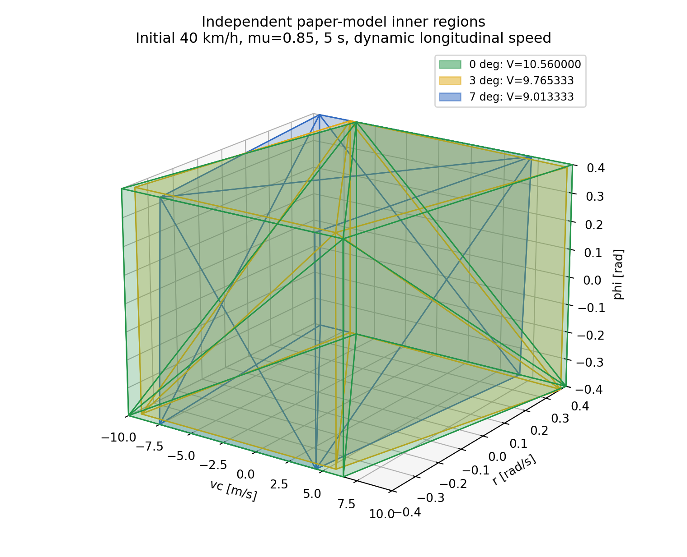

# Xiao 2022 독립 논문 모델 · 요청한 세 조건

**3/3 계산·저장·검증 완료.** 기존 Full-Car/MF 계산과 자동 재개는 중지했습니다. 새 결과는 논문의 5상태 차량 모델과 Burckhardt 타이어 모델을 사용합니다.

초기 속도 40 km/h, μ=0.85, 조향각 0°·3°·7°, 원래 격자 41×31×31=39,401개, 초기 롤 속도 0, 5초, RK4 dt=0.01초입니다. 종방향 속도는 기본 ZIP처럼 식(1)에 따라 동적으로 변합니다.

| 조향각 | 안정점 | 내부 부피 | 물리 기준 위반 | 저속 모델범위 제외 | MAT |
|---|---:|---:|---:|---:|---|
| 0° | 36,983 | 10.560000000 | 0 | 2,418 | [다운로드](https://raw.githubusercontent.com/yodagil/suspension/main/results/paper_xiao2022_40kph_mu0p85/paper_stable_point_40kph_0.85mu_0deg.mat) |
| 3° | 36,731 | 9.765333333 | 168 | 2,502 | [다운로드](https://raw.githubusercontent.com/yodagil/suspension/main/results/paper_xiao2022_40kph_mu0p85/paper_stable_point_40kph_0.85mu_3deg.mat) |
| 7° | 34,405 | 9.013333333 | 3,932 | 1,064 | [다운로드](https://raw.githubusercontent.com/yodagil/suspension/main/results/paper_xiao2022_40kph_mu0p85/paper_stable_point_40kph_0.85mu_7deg.mat) |

물리 기준은 yaw rate·횡가속도·바퀴 들림입니다. 저속 모델범위 제외(u<0.5 m/s)는 논문의 물리적 불안정 판정과 다릅니다. 비유한 수치 실패는 세 조건 모두 0개였습니다.

## 확인한 경향과 검증

기본 동적 속도 가정에서 안정점 수, 전체 안정점 convex hull 부피, 8꼭짓점 내부 부피가 모두 조향각 증가에 따라 감소했습니다. 평균 안정점 yaw rate도 양의 방향으로 이동했습니다. 선택된 8꼭짓점의 평균 yaw rate는 단조 이동하지 않으므로 모든 형상 특징이 논문과 같다고 주장하지 않습니다.

독립 검사 133개를 통과했습니다. 꼭짓점 8개는 실제 안정 격자점이고, 다면체 안의 불안정 격자점은 0개입니다. 식(11)의 하중 잔차는 최대 1.82e-12 N입니다. dt=0.02와 0.01 비교의 판정 차이는 각각 0·8·24개(최대 0.0609%)였으며 내부 부피는 동일했습니다. [전체 검증 보고서](validation_report.json)

[안정점과 영역 그림](paper_stable_samples.png) · [수정 MATLAB ZIP](https://raw.githubusercontent.com/yodagil/suspension/main/downloads/Xiao2022_PaperBased_Stability_Audited.zip) · [실행 파일](../../paper_model/matlab/run_requested_40kph.m)

## 논문 재현 범위

이는 저자 원본 코드가 아닌 공개 정보 기반 재구성입니다. Table 1 값은 그대로 사용했습니다. ms=1170 kg, hphi=0.35 m, Burckhardt [1.28,23.99,0.52], Ks=1, 종슬립 0, 5초 판정시간, 속도 유지 조건, 구체적인 8꼭짓점 선정에는 공개되지 않은 가정이 있습니다. 이 값은 경향을 맞추려고 조정하지 않았습니다.

논문 Figure 6은 0°·3.5°·7°이며 요청 조건의 중간 각도는 3°입니다. 요청한 r=±0.4 격자는 논문 그림의 더 넓은 yaw 영역 일부를 자르며 실제 결과가 격자 경계에 닿습니다. 정량적 부피·형상의 동일 재현을 주장하지 않습니다. 격자 표본의 무위반은 격자 사이 연속 영역이나 점근 안정성의 증명이 아닙니다.

속도를 고정하는 별도 가정에서도 비교했습니다. 안정점 수는 36,921→36,915→35,855개였으나 내부 부피는 9.92→10.506667→10.4로 단조 감소하지 않았습니다. 따라서 부피 경향은 속도 운용 가정과 재구성 알고리즘에 의존합니다. 이 대안은 기본 결과 선택이나 파라미터 피팅에 사용하지 않았습니다. [속도 가정 민감도](speed_mode_sensitivity.json)

논문: Xiao et al., Advanced Engineering Informatics 54 (2022) 101764, DOI [10.1016/j.aei.2022.101764](https://doi.org/10.1016/j.aei.2022.101764).
